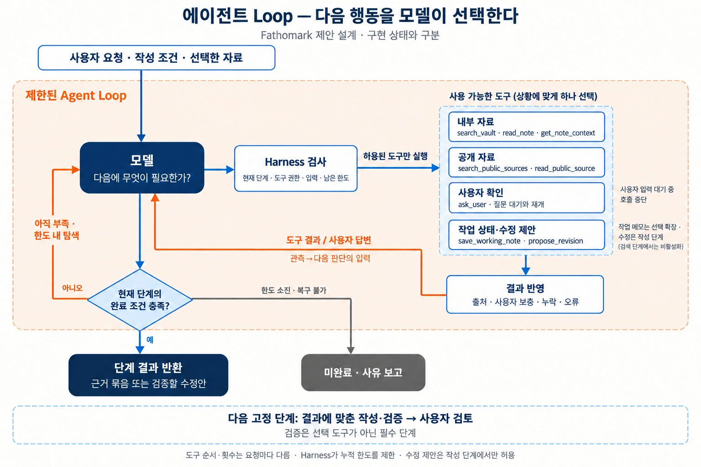

# Agent Loop: 관측에 따른 행동 선택

상태: **설계 · 부분 구현** ([구현 현황](README.md#구현-현황))  
기준일: 2026-10-11  
[문서 목차](README.md)

그림. 에이전트는 다음 행동을 선택하지만 전체 작업의 통과 조건을 변경하지 않는다.

모델은 필요한 정보가 어디에 있는지에 따라 도구를 고른다. 경험 후보가 없으면 Vault 검색, 후보가 있으나 본인 행동이 불명확하면 원문 읽기나 연결 문맥 조회, 기록으로 해결되지 않으면 사용자 질문을 제안한다. 공고·기업 정보가 필요한 요청에서는 허용된 공개 자료를 읽거나 검색한다. 모든 도구를 순서대로 호출하는 파이프라인이 아니다.

탐색 단계에서는 승인 가능한 수정안 생성이나 에디터 쓰기를 허용하지 않는다. 부분 수정 단계에서는 `propose_revision`을 사용할 수 있지만 필수 검증을 통과해야 미리보기로 넘어간다. 도구 등록 목록 전체를 매 단계 제공하기보다 현재 단계에 필요한 도구만 제공한다.

문항 분석, 경험 비교, 근거표, 개요와 초안 비평은 작성 절차로 시작한다. 별도의 `think` 도구나 숨은 추론 기록을 만드는 대신 필요한 사실, 경험 선택 이유, 구성 대안과 수정 근거를 검토 가능한 결과로 남긴다.

## 관련 문서

[전체 워크플로우](overall-workflow.md) · [도구별 문서](tools/README.md) · [실행 정책](execution-policy.md)
