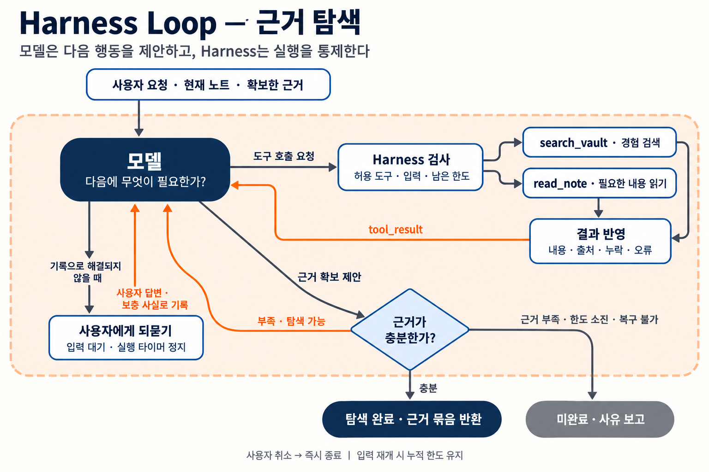

# Harness Loop: 실행·권한·대기의 경계

상태: **설계 · 부분 구현** ([구현 현황](README.md#구현-현황))  
기준일: 2026-10-11  
[문서 목차](README.md)

그림. 근거 탐색은 반복하되 권한·한도·대기·종료는 Harness가 관리한다.

Harness는 모델의 검색·읽기·질문·근거 확보 제안을 구조화된 행동으로 받는다. 도구 입력과 허용 범위, 남은 호출 수를 검사하고 실행 결과를 내용·출처·누락·오류로 구분해 저장한다. 오류를 빈 검색 결과로 바꾸지 않는다. 복구 가능한 오류만 제한된 재시도 대상으로 삼고, 한도 소진·지속 오류·취소는 성공과 구분한다.

모델의 “충분하다”는 선언은 작성 가능성 검사에 들어가는 제안이다. 문항에 대응하는 경험과 필요한 본인 행동이 출처 또는 사용자 보충에 연결되고, 중요한 충돌이 해결돼 있어야 작성할 수 있다. 숫자 성과는 필수 항목으로 강제하지 않는다. 확인되지 않은 수치는 생략한다.

일반 채팅(`chat`)의 [Loop](../../../plugin/src/harness/agent-loop.ts)는 도구 호출이 없는 응답을 완료로 처리한다. 커리어 모드(`career`)는 별도의 [작성 흐름](../../../plugin/src/workflow/career-graph.ts)으로 실행되며, 도구 호출이 없는 탐색 응답은 **탐색 완료 제안**일 뿐이다. 이어서 모델이 개인 근거와 필요한 사실·충돌을 판정하는 작성 가능성 검사를 통과해야 개요·초안으로 간다. 탐색 중 모델이 고른 도구는 입력 형식 오류를 한 번 되돌려 고칠 기회를 받고, 권한 거부는 건너뛰며, 그 밖의 도구 오류는 실행을 끝낸다. 도구 호출 없음이 전체 글쓰기 완료나 검증 통과를 의미해서는 안 된다.

## 관련 문서

[전체 워크플로우](overall-workflow.md) · [도구별 문서](tools/README.md) · [실행 정책](execution-policy.md)
