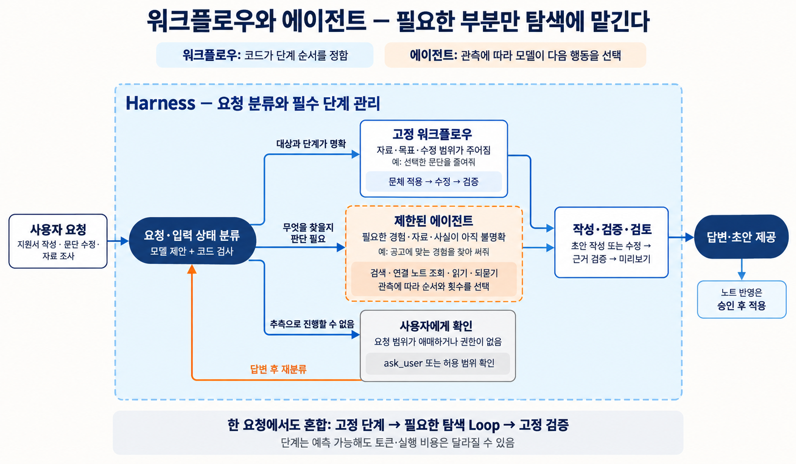

# 전체 커리어 글쓰기 워크플로우

상태: **설계 · 부분 구현** ([구현 현황](README.md#구현-현황))  
기준일: 2026-10-11  
[문서 목차](README.md)

전체 순서는 다음과 같다.

**요청 정리 → 필요한 사실 목록 → 근거 확보 → 경험·개요 선택 → 초안 → 필수 검증 → 답변·미리보기 → 선택적 승인 후 적용**

근거 확보에는 검색·읽기·연결 노트 조회·사용자 질문을 조건부로 사용한다. 이미 근거가 충분하면 추가 탐색이나 질문을 생략한다. 검증 실패는 수정 초안 1회와 재검증으로 처리하며, 재검증이 통과하면 미리보기로 진행한다. 여전히 실패하거나 새 사실을 확보해야 하면 초기 버전은 부족한 내용을 보고하고 미완료로 종료한다. 후속 보충은 기존 결과를 참고하는 새 요청으로 시작한다.

## 실행 경로

근거 확보의 실행 방식은 [워크플로우·에이전트 선택](workflow-routing.md)에서 정의한다. 탐색 실행의 한도와 대기는 [Harness Loop](harness-loop.md), 모델의 행동 선택은 [Agent Loop](agent-loop.md), 사실의 출처 구분은 [근거·상태 계약](evidence-model.md)을 따른다.

## 시각화

그림. 전체 단계는 고정하고, 다음 행동을 미리 정하기 어려운 탐색만 에이전트에 맡긴다.
