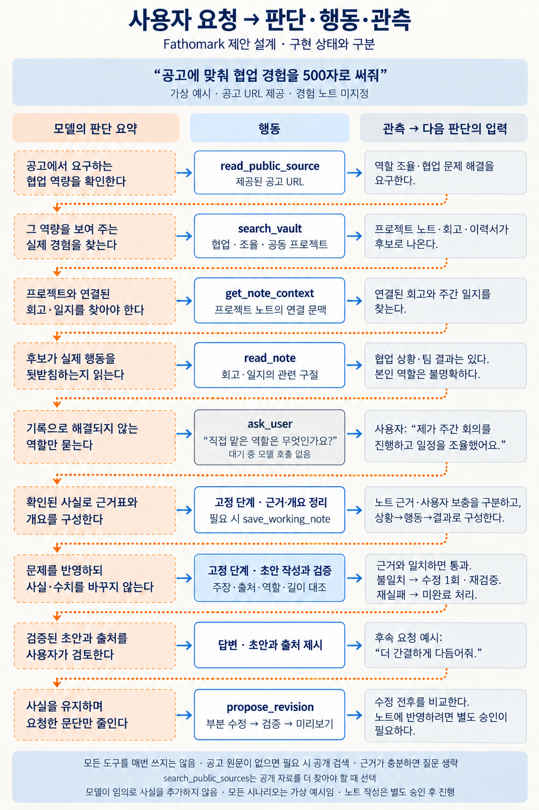

# 요청 사례: 판단·행동·관측의 흐름

상태: **설계 · 부분 구현** ([구현 현황](README.md#구현-현황))  
기준일: 2026-10-11  
[문서 목차](README.md)

그림. 가상 사례다. 실제 사용자 기록이나 실행 결과가 아니다.

입력은 “공고에 맞춰 협업 경험을 500자로 써줘”이며 사용자가 허용된 공고 URL과 문항을 제공했다고 가정한다. 아래의 ‘판단’은 숨은 추론이 아니라 다음 행동을 설명하는 간단한 판단 요약이다. 글자 수에 공백·출처 표시를 포함할지는 실제 문항의 기준에 맞춰 확인한다.

| 판단 요약 | 행동 | 관측 → 다음 판단의 입력 |
|---|---|---|
| 공고의 협업 요구를 확인해야 한다 | `read_public_source` | 역할 조율 역량 요구. 경험 근거와 별도 보존 |
| 어떤 경험이 적합한지 모른다 | `search_vault` | 프로젝트 회고·이력서·공부 노트 후보 |
| 회고에 연결된 자료가 있는지 확인한다 | `get_note_context` | 연결된 주간 일지 후보. 링크 자체는 근거 아님 |
| 실제 본인 행동을 확인한다 | `read_note` | 팀 결과는 있으나 일정 조율 담당자가 불명확 |
| 기록으로 역할을 해결할 수 없다 | `ask_user` | “주간 회의를 진행하고 팀원 일정을 조율했다”는 보충 답변 |
| 경험·행동과 출처를 확보했다 | 근거표·개요 구성, 필요 시 `save_working_note` | 노트 결과와 사용자 역할이 분리된 작성 자료 |
| 확인된 사실로 문항에 답할 수 있다 | 초안 작성 → 필수 검증 | 주장·출처 대응 확인. 수치가 없으므로 임의 수치 추가 안 함 |
| 검증한 초안을 검토할 수 있다 | 초안·출처 미리보기 | 작성 응답 완료. 아직 노트 쓰기는 없음 |
| 사용자가 “더 짧게”를 요청했다 | `propose_revision` → 검증·새 미리보기 | 역할·결과 보존 확인 후 새 수정안. 적용은 별도 승인 |

공고 본문을 이미 제공했다면 첫 읽기를 생략한다. 원문에서 역할이 확인되면 질문을 생략한다. 기존 상태가 충분하면 작업 메모 도구도 생략한다. 공개 검색은 이 사례에 필수가 아니다.
