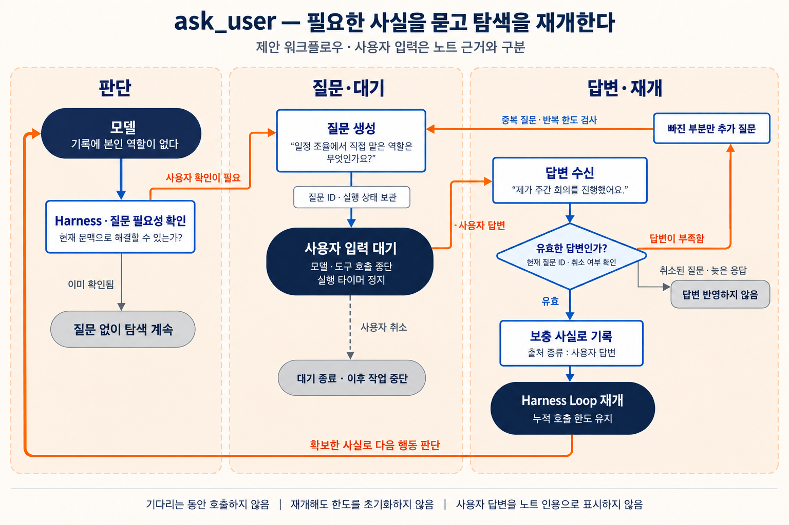

# ask_user

상태: **구현 · 커리어 경로 연결됨 · 대기·재개는 Harness가 관리**

아래 입력·출력과 분기는 요구사항 초안이다. 현재 도구 등록 목록에 구현된 기능으로 설명하지 않는다.

## 기능

노트와 현재 문맥으로 해결할 수 없는 본인 역할·행동·결과 또는 중요한 선택을 사용자에게 묻고 같은 탐색을 재개한다. 질문 문장을 생성하는 것뿐 아니라 입력 대기와 응답 검사가 포함된다.

## 사용 조건

이미 확보한 자료로 해결할 수 없는 항목이 작성 결과를 바꿀 때 사용한다. 후보가 여러 개라는 이유만으로 질문하지 않고 기존 답변으로 해결된 질문은 생략한다.

## 요구사항

| 항목 | 계약 |
|---|---|
| 입력 | 누락 사실·질문·선택지, 현재 실행 ID와 관련 근거 식별자. 질문 횟수와 최대 길이는 구현 전에 확정한다. |
| 출력 | 질문 ID·답변 ID·원문 답변·해결된 항목. 사용자 보충으로 출처 종류를 명시한다. |
| 권한 | 현재 사용자와 작업에 한정한다. 외부 전송·Vault 쓰기를 하지 않는다. |
| 한도·상태 | 질문 ID와 실행 상태를 보관한다. 대기 중 모델·도구 호출과 활성 타이머를 정지하고 재개 후 누적 사용량을 유지한다. |
| 실패 | 취소·종료된 질문의 늦은 응답은 반영하지 않는다. 부족한 답변은 중복·한도 검사 뒤 빠진 부분만 추가 질문한다. |

## 워크플로우

질문 필요성 확인 → 이미 확인됐다면 질문 없이 계속 → 질문과 실행 식별자 보관 → 사용자 입력 대기 → 현재 질문의 유효한 답변인지 확인 → 보충 사실로 기록 → Harness Loop 재개. 취소하면 후속 작업을 중단한다. 앱 재시작 후 자동 재개는 초기 설계에 포함하지 않는다.

## 시각화

그림. ask_user 기능의 실행 경계와 조건별 분기. 시각화는 목표 설계이며 구현 완료를 뜻하지 않는다.

## 검증 기준

대기 중 호출이 일어나지 않고 재개해도 한도가 초기화되지 않는지 확인한다. 중복 답변·늦은 답변·다른 질문 ID를 반영하지 않으며 사용자 답변을 노트 인용으로 표시하지 않는다.

공통 한도·취소·검증 규칙은 [실행 정책](../execution-policy.md)과 [공통 검증 기준](../verification.md)을 따른다.

## 관련 문서

[Harness Loop](../harness-loop.md) · [근거 모델](../evidence-model.md) · [실행 정책](../execution-policy.md) · [도구 목록](README.md) · [설계 문서 목차](../README.md)
