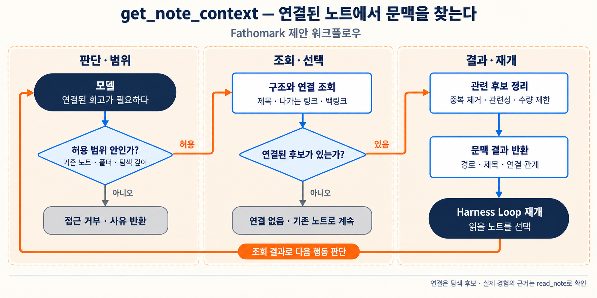

# get_note_context

상태: **구현 · 커리어 경로 연결됨**

아래 입력·출력과 분기는 요구사항 초안이다. 현재 도구 등록 목록에 구현된 기능으로 설명하지 않는다.

## 기능

선택한 노트의 제목 구조와 연결된 회고·일지·프로젝트 노트 후보를 조회한다. 연결 관계는 탐색 후보이며 그 자체로 본인 행동의 증거가 아니다.

## 사용 조건

현재 구절에 필요한 사실이 없고 관련 기록의 위치를 확인할 때 사용한다. 현재 내용이 충분하거나 같은 연결을 이미 확인했다면 생략한다.

## 요구사항

| 항목 | 계약 |
|---|---|
| 입력 | 노트 식별자·필요한 항목·조회 개수와 깊이 한도. 구체 수치는 구현 전에 확정한다. |
| 출력 | 제목 구조·연결 후보·후보 위치·깨진 링크와 누락 상태. 실제 사실 구절은 원문 읽기로 확보한다. |
| 권한 | 허용 Vault 범위 안의 문맥 정보만 읽는다. 외부 전송·노트 변경은 없다. |
| 한도·상태 | 조회한 노트와 연결 후보를 실행에 기록하고 순환 연결·중복 조회를 제한한다. |
| 실패 | 삭제·접근 불가·깨진 링크와 연결 없음은 서로 다르게 반환한다. 범위 밖 자료는 따라가지 않는다. |

## 워크플로우

문맥 추가 확인 필요 → 대상과 허용 범위 검사 → 제목·연결 후보 조회 → 현재 내용으로 충분하면 다음 판단 → 후보가 있으면 `read_note` → 후보가 없으면 다른 검색 또는 보충 질문. 전체 링크 그래프를 무제한 순회하지 않는다.

## 시각화

그림. get_note_context 기능의 실행 경계와 조건별 분기. 시각화는 목표 설계이며 구현 완료를 뜻하지 않는다.

## 검증 기준

순환·중복 연결에서 호출이 늘어나지 않는지 확인한다. 범위 밖 노트는 반환하지 않고 깨진 링크를 원문 부재와 구분한다. 링크만으로 주장 출처를 만들지 않는다.

공통 한도·취소·검증 규칙은 [실행 정책](../execution-policy.md)과 [공통 검증 기준](../verification.md)을 따른다.

## 관련 문서

[원문 읽기](read-note.md) · [Vault 검색](search-vault.md) · [근거 모델](../evidence-model.md) · [도구 목록](README.md) · [설계 문서 목차](../README.md)
