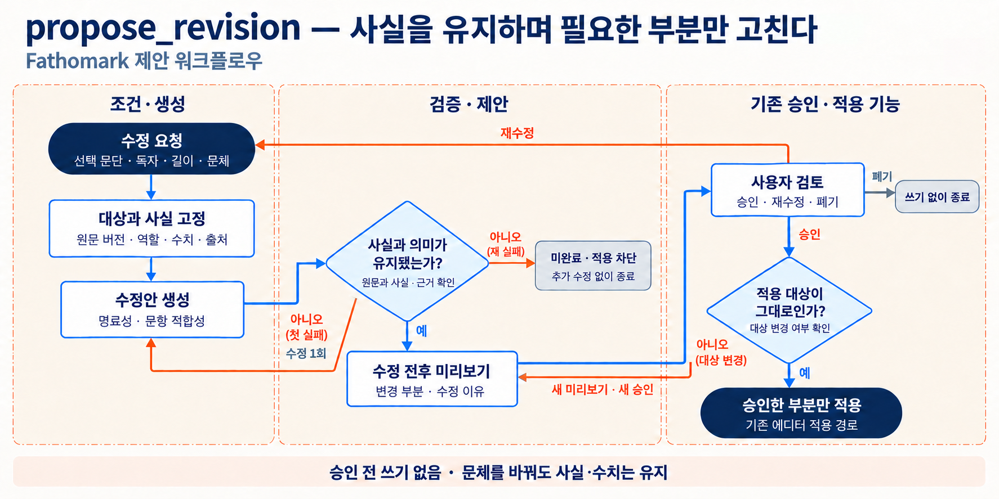

# propose_revision

상태: **구현·등록·미리보기 연결됨**

[구현](../../../../plugin/src/tools/propose-revision.ts)은 호출한 모델이 쓴 수정문을 코드로 검사하는 결정적 도구다. 도구는 모델을 호출하지 않고 노트에 쓰지도 않는다. `createToolRegistry`에 등록돼 있지만 [단계 규칙](../../../../plugin/src/harness/stage.ts)에 따라 탐색 단계에서는 모델에 공개하지 않고 호출도 거부한다. 사용자가 수정할 구절을 선택한 실행만 수정 단계가 된다. 수정 단계의 미리보기는 모델의 글이 아니라 그 실행의 마지막 `ready` 제안에서만 만들며, 제안의 `original`이 선택 구절과 다르면 만들지 않는다. 거절된 제안이 두 번째로 나오면 실행을 `incomplete`(`revision_rejected`)로 끝낸다([구현](../../../../plugin/src/harness/revision.ts)). 승인 때 문서·선택 영역 일치 확인은 기존 `PreviewController`가 한다.

## 기능

지정한 문단을 줄이거나 구성·표현을 개선하고 변경 전후와 수정 이유를 제공한다. 본인 역할·수치·성과와 출처 연결은 보존한다. 실제 노트 적용 권한을 포함하지 않는다.

## 사용 조건

사용자가 수정 대상과 기준을 정했거나 검증에서 수정할 문장이 확인됐을 때 사용한다. 새 사실이 필요한 경우 표현 수정으로 채우지 않고 누락을 보고한다.

## 요구사항

| 항목 | 계약 |
|---|---|
| 입력 | `original`(대상 문단) · `revised`(모델의 수정문) · `criteria`(수정 기준) · `keepFacts`(그대로 남길 구절, 선택). 초안 버전과 출처 연결은 입력이 아니라 문단에 적힌 `[[S1]]` 표기로 확인한다. |
| 출력 | `status`(`ready`·`rejected`·`no_change`) · 원문과 수정문 · 기준 · `issues`(차단 또는 확인 필요 항목). 승인 가능한 미리보기로 넘기는 것은 `ready`뿐이다. |
| 검사 | 차단: 원문에 없던 숫자, 원문에 없던 `[[S…]]` 출처, `keepFacts` 누락. 확인 필요: 사라진 숫자, 사라진 출처. 숫자는 표기 그대로 비교하며 말로 쓴 수나 역할·성과 표현의 의미 변화는 판단하지 않는다. |
| 권한 | 제안만 생성한다. 노트 적용은 별도 검증·미리보기·승인 경로에서 실행한다. |
| 한도·상태 | 도구는 상태가 없다. 거절 뒤 수정은 1회이며 Harness가 센다. 대상 버전은 미리보기가 보관한 선택 영역과 문서 내용으로 확인한다. |
| 실패 | 사실 보존 불가·정보 부족은 질문 또는 미완료로 처리한다. 대상 버전이 바뀌면 새로운 미리보기와 승인을 요구한다. |

## 워크플로우

수정 필요 → 대상·버전·유지 사실 확인 → 부분 수정안 생성 → 주장과 출처 필수 검증 → 통과 시 새 미리보기. 실패하면 허용된 1회 수정·재검증을 거치고 여전히 실패하면 미완료로 종료한다. 승인 시 문서와 선택 영역이 일치하는지 기존 적용 기능으로 확인한다.

## 시각화

그림. propose_revision 기능의 실행 경계와 조건별 분기. 시각화는 목표 설계이며 구현 완료를 뜻하지 않는다.

## 검증 기준

문장을 줄여도 역할·숫자·성과가 바뀌지 않는지 확인한다. 문체 예시의 사실을 섞지 않고 검증 실패 결과를 승인 가능 미리보기로 내보내지 않으며 중복 승인으로 두 번 적용하지 않는다.

문장 의미 수준의 사실 보존은 이 도구가 아니라 후속 주장 검증(S3)의 몫이다. 공통 한도·취소·검증 규칙은 [실행 정책](../execution-policy.md)과 [공통 검증 기준](../verification.md)을 따른다.

## 관련 문서

[전체 작성 흐름](../overall-workflow.md) · [검증 기준](../verification.md) · [기존 적용 기능](../../../../plugin/src/obsidian/insertion-preview.ts) · [도구 목록](README.md) · [설계 문서 목차](../README.md)
