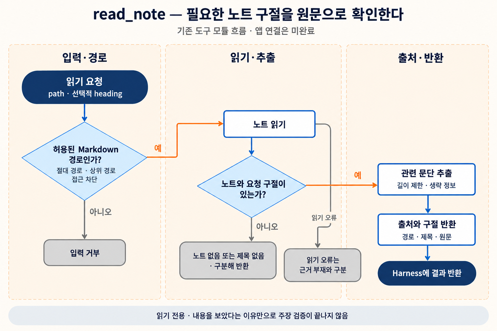

# read_note

상태: **기존 도구 모듈 · 커리어 실행 경로 연결 전**

도구 모듈은 존재하지만 [현재 앱 진입점](../../../../plugin/src/main.ts)은 빈 등록 목록과 가짜 모델을 사용한다. 아래의 기존 계약과 목표 워크플로우를 구분한다.

## 기능

검색된 경험의 본인 역할·행동·결과를 원문에서 확인한다. 전체 파일을 무제한 반환하지 않고 제목 아래의 구절 또는 제한된 본문을 출처와 함께 제공한다.

## 사용 조건

후보 노트가 있으나 검색 구절만으로 사실을 확인할 수 없을 때 사용한다. 기존 구절이 충분하면 추가 읽기를 하지 않는다.

## 요구사항

| 항목 | 계약 |
|---|---|
| 입력 | `path`: Vault 상대 Markdown 경로. 절대 경로·상위 경로 이동은 금지. `heading`: 선택적 1~200자 제목. 그 외 입력은 거부한다. |
| 출력 | 노트 경로·선택적 제목·구절을 담은 `references`, 누락을 담은 `omitted`. 파일이 없으면 `error.code: not_found`. |
| 권한 | 현재 정책에서 승인 없는 읽기만 허용. 파일 수정과 외부 전송은 없다. |
| 한도·상태 | 제한 시간 10초, 결과 예산 1,400토큰. 구절 합계 최대 4,096 UTF-8 바이트. 제목 선택 여부와 누락 사유를 유지한다. |
| 실패 | 파일 부재와 제목 부재를 구분한다. 제목이 없으면 `omitted`로 알리고 긴 문단이나 추가 문단이 빠졌음을 표시한다. |

## 워크플로우

필요한 사실 판단 → 안전한 경로와 호출 조건 검사 → 원문 읽기 → 제목 선택과 길이 제한 → 구절·출처 반환. 사실이 확보되면 근거표에 연결하고, 제목이나 파일이 없으면 제한된 다른 읽기·검색을 제안한다. 내용이 없다고 사용자의 경험 부재를 단정하지 않는다.

## 시각화

그림. read_note 기능의 실행 경계와 조건별 분기. 시각화는 목표 설계이며 구현 완료를 뜻하지 않는다.

## 검증 기준

절대 경로·상위 이동·Markdown 이외의 경로를 거부하는지 확인한다. 제목 없는 결과와 삭제된 파일을 구분하고, 잘린 내용을 전체 원문처럼 표시하지 않으며 역할·성과 주장에 실제 구절을 연결한다.

공통 한도·취소·검증 규칙은 [실행 정책](../execution-policy.md)과 [공통 검증 기준](../verification.md)을 따른다.

## 관련 문서

[현재 도구 계약](../../../../plugin/src/tools/vault-tools.ts) · [구절 선택](../../../../plugin/src/tools/vault-search.ts) · [노트 문맥](get-note-context.md) · [도구 목록](README.md) · [설계 문서 목차](../README.md)
