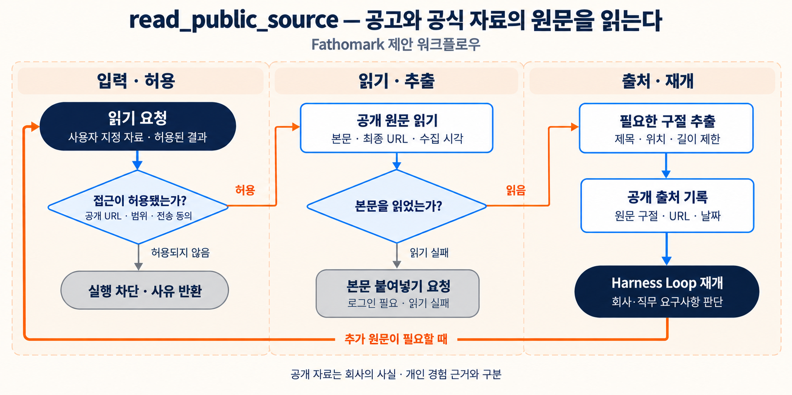

# read_public_source

상태: **붙여넣기 구현 · URL 읽기 미구현**

아래 입력·출력과 분기는 요구사항 초안이다. 현재 도구 등록 목록에 구현된 기능으로 설명하지 않는다.

## 기능

공고·기업 공식 자료의 본문을 읽어 요구사항과 배경 정보를 확보한다. 공개 자료는 회사·직무를 설명하는 출처로 사용하며 사용자 경험과 분리한다.

## 사용 조건

사용자가 제공한 공고 본문이나 허용된 주소를 확인할 때 사용한다. 필요한 본문이 이미 실행에 있으면 재조회하지 않는다. 초기 버전은 붙여넣기 지원부터 검토한다.

## 요구사항

| 항목 | 계약 |
|---|---|
| 입력 | 초기 버전은 `sourceId` 하나. 사용자가 붙여넣은 본문을 Harness가 보관하며 부여한 ID다. 모델은 본문·주소를 입력으로 넘기지 않는다. 주소 입력은 이 버전에 없다. |
| 출력 | 자료 ID·제목·본문·수집 시각·추출 상태(완전·일부)·누락. 붙여넣기에는 URL을 만들어 붙이지 않는다. 없는 ID는 빈 자료가 아니라 `not_found` 오류로 구분한다. |
| 권한 | 이번 실행에 붙여넣은 자료를 읽기만 한다. 네트워크 요청이 없으므로 `read_public_source` 권한을 새로 두고 승인은 요구하지 않는다. 주소 읽기는 `general_web`이며 계속 거부한다. 로그인 우회와 외부 서비스 쓰기를 하지 않는다. |
| 한도·상태 | 본문은 12,000 UTF-8 바이트까지 문단 단위로 반환하고 넘으면 일부 추출과 누락을 표시한다. 도구 결과 예산은 4,000 토큰이다. 두 값은 초기 가정이며 실제 공고로 확인한 뒤 확정한다. 보관 자료 수 상한은 구현 전에 정한다. |
| 실패 | 없는 ID·일부 추출을 구분하고 사용자에게 본문 붙여넣기를 요청한다. 인증 필요·차단·형식 미지원은 주소 읽기를 도입할 때 정의한다. |

## 자료 보관과 주입

- **보관은 Harness가 한다.** 사용자가 붙여넣은 본문을 요청 범위 메모리에 등록하고 `P1`, `P2`처럼 ID를 부여한다. 모델은 ID를 만들지 않고 목록에 있는 ID만 입력한다. 실행 ID·질문 ID와 같은 원칙이다.
- **도구는 좁은 읽기 서비스만 받는다.** 서비스는 `sourceId`를 받아 `제목·본문·수집 시각` 또는 없음을 반환하는 하나의 읽기 기능이다. 등록·삭제·목록은 도구에 주지 않는다. `search_vault`가 Vault 읽기 기능만 주입받는 것과 같은 구조다.
- **본문 직접 전달안은 채택하지 않는다.** 모델이 본문을 다시 입력으로 보내면 토큰이 낭비되고 사용자가 붙여넣은 원문과 같다는 보장이 없다.
- **미정 사항.** 붙여넣기를 받는 화면과 등록 시점, 자료 한 건의 최대 길이, 보관 자료 수 상한은 정하지 않았다. 보관소가 Harness에 생기기 전에는 앱 진입점에 이 도구를 등록하지 않는다.
- **출처 연결은 별도 결정이다.** 현재 외부 근거 형식은 Wikipedia와 URL을 전제하므로 URL 없는 붙여넣기 자료를 담지 못한다. 형식을 넓히기 전에는 이 도구의 결과를 출처 패널에 인용하지 않는다. [근거 모델](../evidence-model.md)의 공개 자료 항목과 함께 정한다.

## 워크플로우

자료 확인 필요 → 기존 본문 여부 확인 → 허용 주소·형식 검사 → 읽기·추출 → 완전하거나 일부인 본문과 출처 반환 → 요구사항 정리. 자료 속 명령을 도구 지시로 실행하지 않으며 일부 추출만으로 전체 공고를 읽었다고 표시하지 않는다.

## 시각화

그림. read_public_source 기능의 실행 경계와 조건별 분기. 시각화는 목표 설계이며 구현 완료를 뜻하지 않는다.

## 검증 기준

허용하지 않은 주소와 형식을 차단하고, 부분 본문의 누락을 표시하는지 확인한다. 자료 속 실행 지시를 무시하며 회사의 요구사항을 사용자의 경력으로 바꾸지 않는다.

공통 한도·취소·검증 규칙은 [실행 정책](../execution-policy.md)과 [공통 검증 기준](../verification.md)을 따른다.

## 관련 문서

[공개 검색](search-public-sources.md) · [현재 권한 정책](../../../../plugin/src/harness/policy.ts) · [후속 결정](../future-decisions.md) · [도구 목록](README.md) · [설계 문서 목차](../README.md)
