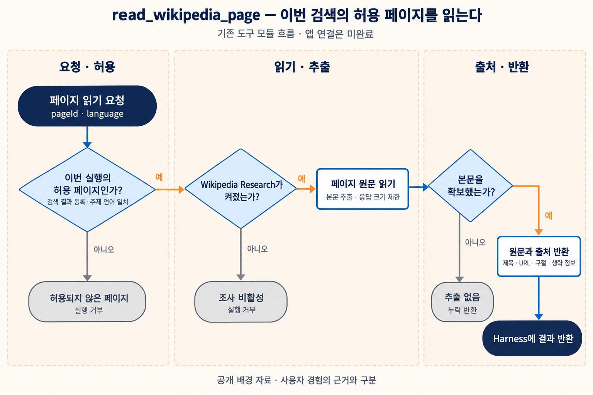

# read_wikipedia_page

상태: **구현 · 연구 설정을 켠 경우에만 제공**

이 도구는 [앱 진입점](../../../../plugin/src/main.ts)의 Registry에 등록되어 실제 로컬 모델의 커리어 실행 경로에서 쓰인다. 아래 계약과 현재 구현의 차이는 [구현 현황](../README.md#구현-현황)을 본다.

## 기능

같은 실행의 Wikipedia 검색에서 반환한 페이지를 읽어 공개 배경 자료의 본문과 출처를 확보한다. 공개 배경 설명을 사용자 경험의 증거로 사용하지 않는다.

## 사용 조건

검색 요약만으로 공개 사실을 확인할 수 없고 읽을 후보가 정해졌을 때 사용한다. 임의 URL이나 검색에서 나오지 않은 페이지를 직접 열지 않는다.

## 요구사항

| 항목 | 계약 |
|---|---|
| 입력 | 양의 정수 `pageId`와 `language: ko 또는 en`. 언어는 현재 공개 주제와 같아야 한다. |
| 출력 | `kind: external`, `source: wikipedia`, 제목·URL·구절·페이지 ID·언어. 누락 사유는 `omitted`에 담는다. |
| 권한 | 현재 실행의 허용 페이지 목록과 Research 설정을 모두 검사한다. 쓰기나 인증 우회는 없다. |
| 한도·상태 | 제한 시간 10초, 결과 예산 1,400토큰. 응답 최대 1 MiB, 선택 본문 최대 4,096 UTF-8 바이트. |
| 실패 | 미허용 페이지·언어 불일치·설정 꺼짐·네트워크 오류를 거부한다. 일반 텍스트 본문이 없으면 빈 출처와 누락 이유를 반환한다. |

## 워크플로우

후보 내용 확인 필요 → 언어·허용 페이지·설정 검사 → 본문 추출 → 문단 길이 제한 → 공개 출처 반환. 충분하면 배경 설명에 연결하고 일부 누락이면 한계를 표시한다. 원문 부재나 오류 시 사용자 경험을 대신하는 근거로 채우지 않는다.

## 시각화

그림. read_wikipedia_page 기능의 실행 경계와 조건별 분기. 시각화는 목표 설계이며 구현 완료를 뜻하지 않는다.

## 검증 기준

다른 실행의 페이지와 다른 언어를 차단하는지 확인한다. 본문이 없는 결과와 네트워크 실패를 구분하고, 출처 종류를 공개 자료로 유지하며 문단 누락을 알린다.

공통 한도·취소·검증 규칙은 [실행 정책](../execution-policy.md)과 [공통 검증 기준](../verification.md)을 따른다.

## 관련 문서

[현재 구현](../../../../plugin/src/tools/wikipedia.ts) · [Wikipedia 검색](search-wikipedia.md) · [공개 자료 읽기 제안](read-public-source.md) · [도구 목록](README.md) · [설계 문서 목차](../README.md)
