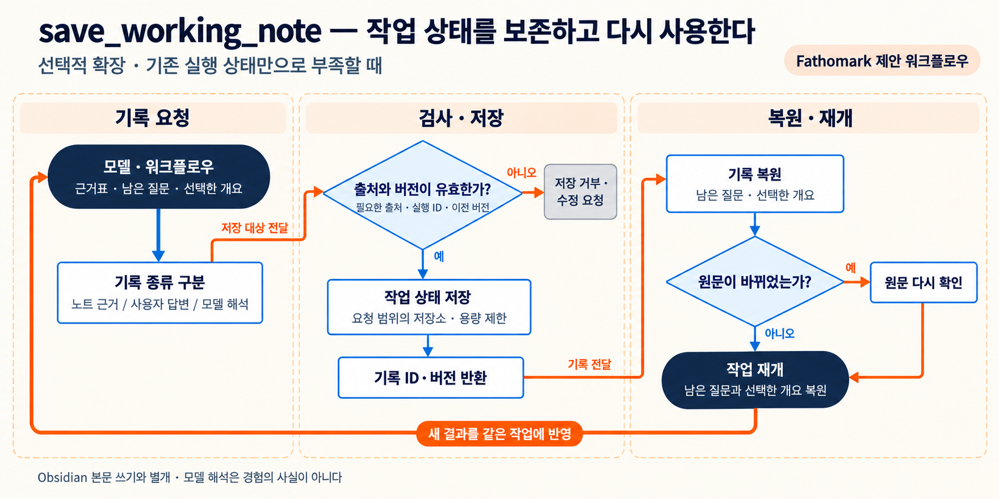

# save_working_note

상태: **제안 설계 · 구현 전**

아래 입력·출력과 분기는 요구사항 초안이다. 현재 도구 등록 목록에 구현된 기능으로 설명하지 않는다.

## 기능

근거표·남은 질문·선택한 경험·개요를 같은 요청의 임시 작업 상태로 보존한다. 기존 상태 관리로 충분하면 이 도구를 별도로 추가하지 않는다. 이름과 달리 Vault 파일 생성 기능이 아니다.

💡 **근거표**: 사용할 주장과 이를 지지하는 원문 구절을 연결한 표다. 사용자 보충·해석·누락을 확인된 노트 사실과 구분한다.

## 사용 조건

여러 탐색 결과를 후속 작성에 재사용해야 하고 기존 실행 상태만으로 전달이 어려울 때 사용하는 선택적 확장이다.

## 요구사항

| 항목 | 계약 |
|---|---|
| 입력 | 실행 ID·근거표·누락·선택 개요·현재 상태 버전. |
| 출력 | 상태 ID·저장 버전·저장 결과. 사실 항목의 원래 출처 ID를 유지한다. |
| 권한 | 요청 범위의 임시 상태만 변경한다. Vault 노트 생성과 외부 전송은 하지 않는다. |
| 한도·상태 | 초기 대기는 메모리 보관을 기준으로 한다. 메모·항목 크기 상한을 정하고 해석과 사실을 분리한다. |
| 실패 | 종료된 실행·상태 버전 충돌·저장 실패는 거부하거나 보고한다. 사용자 노트에 임의 저장하는 우회를 하지 않는다. |

## 워크플로우

상태 보존 필요 → 기존 실행 상태로 충분하면 생략 → 실행 ID·출처·버전 검사 → 요청 범위 저장 → 저장 버전 반환 → 이후 판단에 재사용. 앱 재시작 후 자동 복구는 하지 않으며 영속 저장은 보관 기간·삭제·복구 범위를 결정한 뒤 도입한다.

## 시각화

그림. save_working_note 기능의 실행 경계와 조건별 분기. 시각화는 목표 설계이며 구현 완료를 뜻하지 않는다.

## 검증 기준

다른 실행의 상태를 덮어쓰지 않고 오래된 버전·종료된 실행을 거부하는지 확인한다. 요약 메모가 새로운 사실 출처로 승격되지 않으며 저장 실패 후 Vault 파일을 만들지 않는다.

공통 한도·취소·검증 규칙은 [실행 정책](../execution-policy.md)과 [공통 검증 기준](../verification.md)을 따른다.

## 관련 문서

[근거 모델](../evidence-model.md) · [실행 정책](../execution-policy.md) · [후속 결정](../future-decisions.md) · [도구 목록](README.md) · [설계 문서 목차](../README.md)
