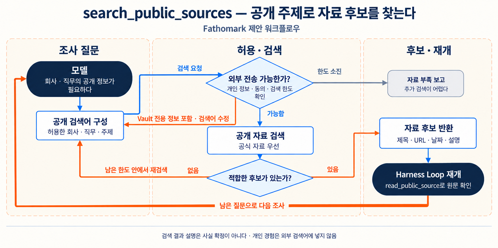

# search_public_sources

상태: **독립 모듈 · 미등록(의도적 보류)**

아래 입력·출력과 분기는 요구사항 초안이다. 현재 도구 등록 목록에 구현된 기능으로 설명하지 않는다.

## 기능

회사·직무·산업의 공개 자료 후보를 검색하고 공식 출처를 우선 선별한다. 검색 요약은 읽을 자료를 선택하는 데 사용하며 확인된 원문과 구분한다.

## 사용 조건

공개 조사가 요청 범위에 포함되고 제공된 자료로 해결할 수 없을 때 사용한다. 경험 노트 탐색에 항상 필요한 단계로 두지 않는다.

## 요구사항

| 항목 | 계약 |
|---|---|
| 입력 | 허용된 공개 검색 질문·자료 범위·결과 개수 한도. Vault에서만 얻은 비공개 표현을 보내지 않는다. |
| 출력 | 후보 ID·제목·URL·요약·출처 정보. 가능한 경우 자료 시점을 포함하되 확인 못한 날짜를 만들지 않는다. |
| 권한 | 승인된 공개 조사 범위만 전송한다. 현재 일반 웹 접근은 금지이므로 제공자와 권한 계약부터 결정한다. |
| 한도·상태 | 결과 개수·질문 변경·재시도 상한을 확정하고 공개 질의와 후보 선택 이력을 보관한다. |
| 실패 | 외부 전송 경계 위반은 요청 전에 차단한다. 서비스 오류·관련 후보 없음·한도 소진을 구분한다. |

## 워크플로우

공개 조사 필요 → 전송할 질문과 범위 검사 → 후보 검색 → 관련성·공식성·시점으로 선별 → `read_public_source`로 원문 확인. 후보가 부족하면 제한된 질문 변경 후 다시 검색하고, 계속 부족하면 사용자 자료 제공 요청 또는 미완료 사유를 반환한다.

## 시각화

그림. search_public_sources 기능의 실행 경계와 조건별 분기. 시각화는 목표 설계이며 구현 완료를 뜻하지 않는다.

## 검증 기준

Vault 전용 이름·문구·경로가 외부 질문에 포함되지 않는지 확인한다. 검색 요약만을 사실 출처로 사용하지 않고 서비스 오류를 결과 없음으로 처리하지 않으며 재검색을 제한한다.

공통 한도·취소·검증 규칙은 [실행 정책](../execution-policy.md)과 [공통 검증 기준](../verification.md)을 따른다.

## 관련 문서

[원문 읽기](read-public-source.md) · [외부 전송 경계](../../../adr/0004-protect-vault-only-terms-from-research-egress.md) · [후속 결정](../future-decisions.md) · [도구 목록](README.md) · [설계 문서 목차](../README.md)
