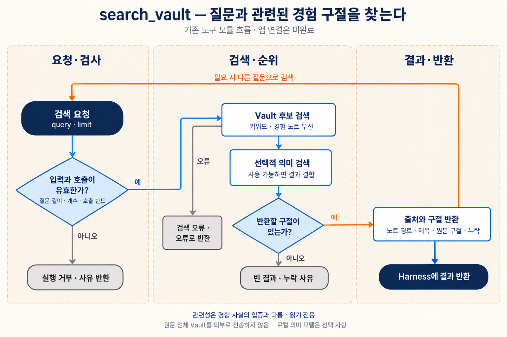

# search_vault

상태: **구현 · 커리어 경로 연결됨 · 의미 검색과 판정은 설정으로 켬(기본 켬)**

도구 모듈은 존재하지만 [현재 앱 진입점](../../../../plugin/src/main.ts)은 빈 등록 목록과 가짜 모델을 사용한다. 아래의 기존 계약과 목표 워크플로우를 구분한다.

## 기능

사용자의 노트에서 문항에 맞는 경험 후보와 관련 구절을 찾는다. 경험 노트 우선순위와 선택적 의미 검색을 활용하되, 검색 관련성을 본인 경험의 입증으로 간주하지 않는다.

💡 **의미 검색**: 같은 단어가 없어도 내용의 유사성을 이용해 자료를 찾는 방식이다. 의미 검색 기반이 없거나 사용할 수 없으면 기존 단어 검색으로 돌아간다.

## 사용 조건

사용자가 경험을 지정하지 않았거나 확보한 구절로 문항에 답하기 어려울 때 사용한다. 이미 필요한 사실이 충분하면 생략한다.

## 요구사항

| 항목 | 계약 |
|---|---|
| 입력 | `query`: 공백 제거 후 1~200자. `limit`: 정수 1~10, 기본 5. 정의되지 않은 입력은 거부한다. |
| 출력 | `references`: `kind: vault`, `path`, 선택적 `heading`, `excerpt`. `omitted`: 누락 사유. 공통 출력 정의에는 선택적 `not_found` 오류도 있다. |
| 권한 | 현재 정책에서 승인 없는 Vault 읽기. 외부 전송과 내용 변경은 없다. 단계별 허용 폴더는 현재 입력에 없으므로 추가 계약이 필요하다. |
| 한도·상태 | 도구 제한 시간 10초, 결과 예산 1,400토큰. 단어 검색은 최대 1,000개 노트를 읽으며 누락을 알린다. 전체 호출 한도는 실행 정책을 따른다. |
| 실패 | 결과 없음, 검색 대상 삭제, 의미 검색 불가, 취소를 구분한다. 예외를 빈 결과로 바꾸지 않는다. |

## 워크플로우

검색 필요성 판단 → 입력·권한·한도 검사 → 후보 검색 → 구절·출처·누락 반환 → 충분하면 다음 단계로 진행한다. 후보의 역할·행동이 불명확하면 `read_note` 또는 `get_note_context`로 이어지고, 후보가 없으면 제한된 재검색 후 사용자 보충을 요청한다.

검색 내부의 `supported`·`reason` 판정은 현재 도구 출력 스키마에 선언돼 있지 않다. 이를 Harness의 작성 통과 조건으로 쓰려면 반환 계약을 별도로 확정해야 한다.

## 시각화

그림. search_vault 기능의 실행 경계와 조건별 분기. 시각화는 목표 설계이며 구현 완료를 뜻하지 않는다.

## 검증 기준

경험 후보의 구절과 경로가 함께 반환되는지 확인한다. 잘못된 입력은 실행 전에 차단하고, 1,000개 제한의 누락을 알리며, 취소를 검색 실패로 삼지 않아야 한다. 검색 후보만으로 확인되지 않은 역할이나 성과를 만들지 않는다.

공통 한도·취소·검증 규칙은 [실행 정책](../execution-policy.md)과 [공통 검증 기준](../verification.md)을 따른다.

## 관련 문서

[현재 도구 계약](../../../../plugin/src/tools/vault-tools.ts) · [검색 구현](../../../../plugin/src/tools/vault-search.ts) · [원문 읽기](read-note.md) · [도구 목록](README.md) · [설계 문서 목차](../README.md)
