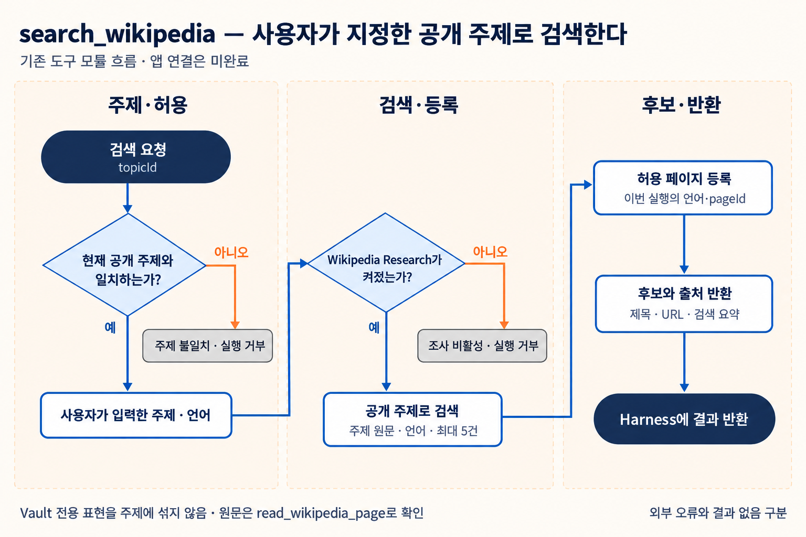

# search_wikipedia

상태: **구현 · 연구 설정을 켠 경우에만 제공**

도구 모듈은 존재하지만 [현재 앱 진입점](../../../../plugin/src/main.ts)은 빈 등록 목록과 가짜 모델을 사용한다. 아래의 기존 계약과 목표 워크플로우를 구분한다.

## 기능

사용자가 직접 입력한 공개 주제로 Wikipedia 후보를 찾는다. 자유로운 일반 웹 검색이나 사용자 경험 검색을 대신하지 않는다.

## 사용 조건

사용자가 별도로 정한 공개 주제가 있고 Wikipedia Research 설정이 켜져 있을 때 배경 지식 조사에 사용한다. 경험 근거 확보를 위해 반드시 호출하는 도구는 아니다.

## 요구사항

| 항목 | 계약 |
|---|---|
| 입력 | `topicId`만 받는다. 현재 실행의 `researchTopic.id`와 일치해야 한다. 검색 문구·언어를 모델이 입력으로 새로 지정하지 않는다. |
| 출력 | 최대 5개 후보의 제목·URL·요약 구절·`pageId`·`language`를 `references`에 반환한다. `omitted`도 포함한다. |
| 권한 | 실행 시 Research 설정을 다시 확인한다. 검색 문구는 사용자 공개 주제에서 가져오며 Vault 전용 표현을 보태지 않는다. |
| 한도·상태 | 제한 시간 10초, 결과 예산 1,400토큰. 응답은 최대 1 MiB. 반환한 언어·페이지 ID를 실행의 허용 목록에 저장한다. |
| 실패 | 설정 꺼짐·주제 ID 불일치·HTTP 오류·리디렉션·크기 초과·잘못된 JSON·취소를 오류로 구분한다. |

## 워크플로우

공개 배경 정보 필요 → 실행 주제·설정 검사 → 허용 Wikipedia API 조회 → 후보 출처와 허용 페이지 목록 기록 → 모델이 읽을 후보 선택. 요약은 후보 선택용이며 실제 주장 확인에는 `read_wikipedia_page`를 사용한다. 결과가 없으면 배경 정보를 확보하지 못했다고 알린다.

## 시각화

그림. search_wikipedia 기능의 실행 경계와 조건별 분기. 시각화는 목표 설계이며 구현 완료를 뜻하지 않는다.

## 검증 기준

ID가 다른 주제로 외부 요청을 보내지 않고, Vault 문구를 검색어에 추가하지 않는지 확인한다. 최대 5개 결과와 허용 목록을 일치시키며 네트워크 실패를 검색 결과 없음으로 표시하지 않는다.

공통 한도·취소·검증 규칙은 [실행 정책](../execution-policy.md)과 [공통 검증 기준](../verification.md)을 따른다.

## 관련 문서

[현재 구현](../../../../plugin/src/tools/wikipedia.ts) · [외부 전송 경계](../../../adr/0004-protect-vault-only-terms-from-research-egress.md) · [Wikipedia 원문](read-wikipedia-page.md) · [도구 목록](README.md) · [설계 문서 목차](../README.md)
