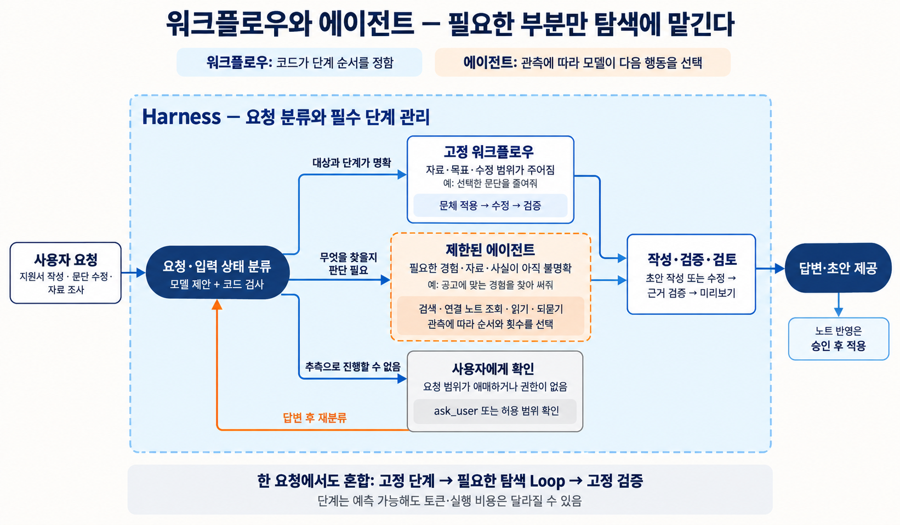

# 워크플로우·에이전트·사용자 확인의 선택

상태: **설계 · 부분 구현** ([구현 현황](README.md#구현-현황))  
기준일: 2026-10-11  
[문서 목차](README.md)

그림. 전체 단계는 고정하고, 다음 행동을 미리 정하기 어려운 탐색만 에이전트에 맡긴다.

| 요청 상태 | 사용할 방식 | 예시와 범위 |
|---|---|---|
| 대상·사실·수정 기준이 명확함 | 고정 워크플로우 | 선택한 문단을 사실을 유지하며 줄이기. 필요 시 원문 확인 후 수정·검증 |
| 어떤 경험과 자료가 필요한지 결과를 보며 결정해야 함 | 제한된 에이전트 탐색 + 고정 작성 단계 | 협업 경험 찾기, 연결 회고 읽기, 누락된 본인 역할 확인 |
| 문항이나 대상 선택이 작업 결과를 크게 바꾸며 문맥으로 해결 불가 | 사용자 확인 후 해당 경로 재개 | 서로 다른 경험 중 강조할 경험 선택, 누락된 문항 제공 |
| 범위 밖이거나 자료 접근이 불가함 | 사유 안내 | 지원하지 않는 자료 형식, 허용되지 않은 접근 |

초기 버전에서는 사람이 처리하는 고객지원 라우팅을 그대로 도입하지 않는다. 모호함은 구체적인 사용자 질문으로 해결한다. 또한 고정 워크플로우도 모델 호출 비용이 발생한다. 호출 상한을 정할 수는 있지만 토큰 길이, 모델 가격과 응답 시간까지 같아지는 것은 아니므로 정확한 비용을 보장하지 않는다.

## 관련 문서

[전체 워크플로우](overall-workflow.md) · [Harness Loop](harness-loop.md) · [Agent Loop](agent-loop.md)
